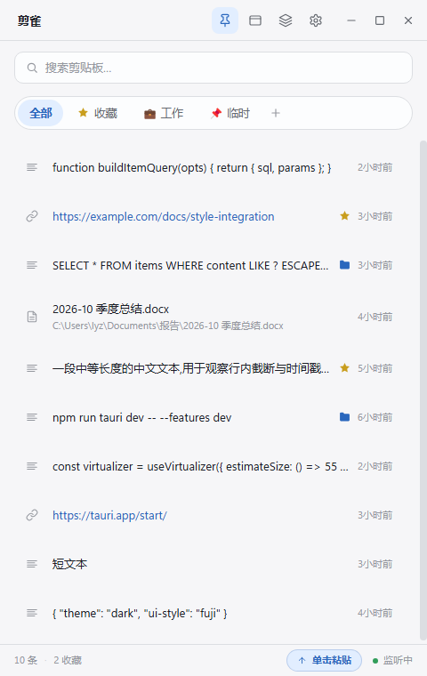
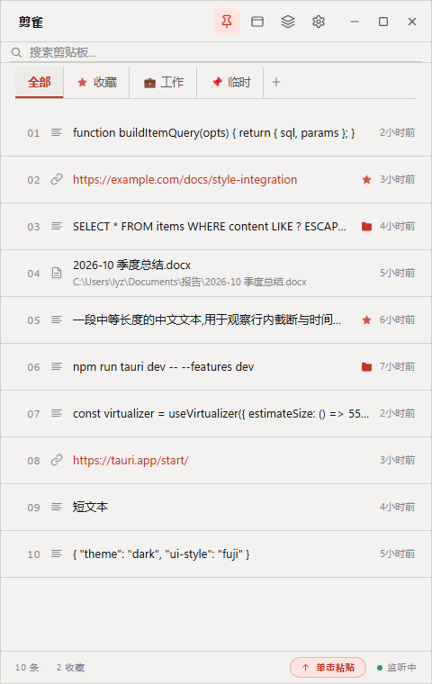
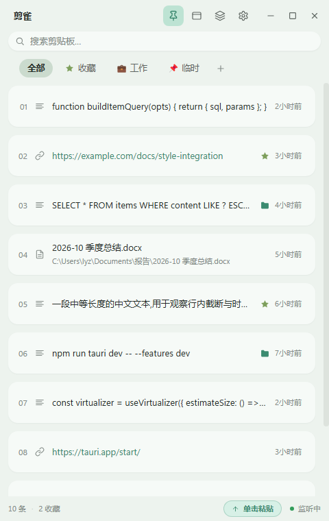
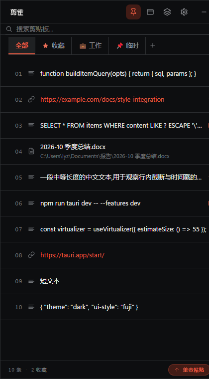
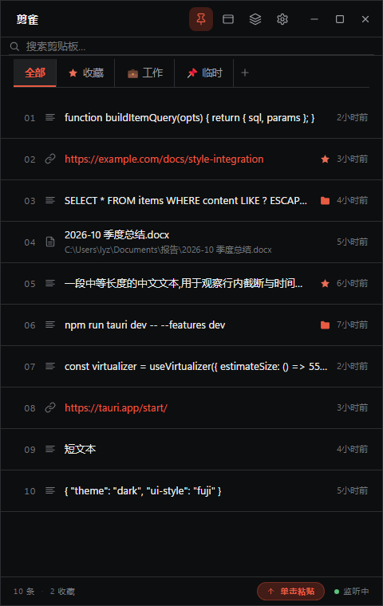
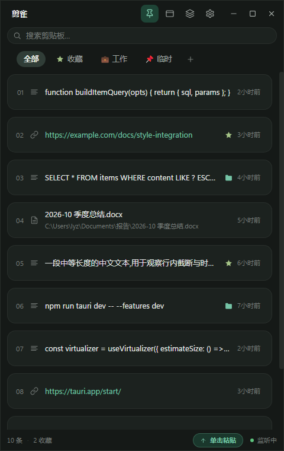

<p align="center">
  
</p>

# 剪雀 Sparrow

<p align="center">召之即来，挥之即去。一个常驻约 10 MB 的 Windows 剪贴板管理器。</p>

<p align="center">
  
  
  
  
</p>

复制过的内容自动留档，热键唤出、单击即贴；可以一键接管 `Win+V`，也可以框选多条按顺序连续粘贴。数据全部存在本地，不依赖账号，不做云同步，除「检查更新」外不发起任何网络请求。

## 界面

三种界面风格，均支持浅色 / 深色主题，可在「设置 → 外观」中切换。点击图片查看 480×760 原图。

<table>
  <tr>
    <th align="center">浮笺</th>
    <th align="center">瑞士索引</th>
    <th align="center">雾绿工作台</th>
  </tr>
  <tr>
    <td align="center"><a href="docs/screenshot-light.png"></a></td>
    <td align="center"><a href="docs/screenshot-swiss-light.png"></a></td>
    <td align="center"><a href="docs/screenshot-mist-light.png"></a></td>
  </tr>
  <tr>
    <td align="center">浅色</td>
    <td align="center">浅色</td>
    <td align="center">浅色</td>
  </tr>
  <tr>
    <td align="center"><a href="docs/screenshot-dark.png"></a></td>
    <td align="center"><a href="docs/screenshot-swiss-dark.png"></a></td>
    <td align="center"><a href="docs/screenshot-mist-dark.png"></a></td>
  </tr>
  <tr>
    <td align="center">深色</td>
    <td align="center">深色</td>
    <td align="center">深色</td>
  </tr>
</table>

## 三个真正的差异点

### 文件类型：把资源管理器里复制的文件原样贴回去

文本、链接、图片之外，剪雀还记录**文件**：在资源管理器里多选复制，粘贴时按 `CF_HDROP` 原样写回，目标程序收到的就是那些文件本身。Windows 自带的 `Win+V` 不记录文件。

### 框选连贴：一次选好，逐条贴入

填表、录数据时最常见：姓名、手机号、地址分别复制过，框选后按你点选的先后顺序逐条贴进目标窗口，不用在窗口之间来回切换。队列由后端持有，面板关掉也照常继续。

### 约 10 MB：隐藏即销毁，唤出即重建

窗口隐藏时会彻底销毁 WebView2 进程树，内存全额归还系统，常驻后台只剩约 10 MB。代价是再次唤出需要约 1 秒重建窗口——闲置时几乎零开销，这是我们主动做的取舍。

## 下载

- **安装版**：`sparrow-setup.exe`，中文向导，默认安装到 `%LOCALAPPDATA%\Sparrow`，可自选路径；检测到 1.x 旧版时沿用旧安装目录原地升级（见下节）。运行时会请求一次 UAC 确认。
- **便携版**：`sparrow.exe`，放进任意文件夹直接运行，`config/` 与 `data/` 自动生成在 exe 同级目录。
- **GitHub Releases**：<https://github.com/QikiiL/Sparrow/releases/latest>
- **蓝奏云**：<https://wwbwp.lanzoul.com/b00ybd8mej>（密码 `bdlx`）
- **系统要求**：Windows 10 / 11（x64），Microsoft Edge WebView2 运行时（安装向导会按需从微软官方地址下载）。

> 应用以管理员权限运行——这是向管理员窗口粘贴、接管 `Win+V` 所必需的。若火绒等安全软件弹出提示，请选择允许。

### 从 1.x 升级

1.x 的旧名是 Clipboard（主程序 `clipboard-manager-tauri.exe`），安装目录由你在向导里选：常见是 `%LOCALAPPDATA%\clipboard`，也可能是 `D:\clipboard` 这类自定义路径。新版安装器**不猜路径**，而是读旧版卸载项里记录的 `InstallLocation`：

- **检测到旧版 → 原地升级**：直接装回旧目录，不再另建 `%LOCALAPPDATA%\Sparrow`。旧 `config/` 与 `data/` 原地保留（历史、设置、图片都不需要迁移），目录页与重装选择页自动跳过，装完自动启动新版。
- **只有你手动把安装路径改到别的目录时**，安装器才会把旧目录的 `config/` 与 `data/` 复制过去，并且不会覆盖新目录里已有的文件。
- 安装完成后会清理旧版的卸载项、「设置 → 应用」里的旧条目、`Software\lyz\clipboard` 设置键、开始菜单/桌面快捷方式（`clipboard.lnk` 等）以及旧主程序 `clipboard-manager-tauri.exe`；旧目录里的其它文件不会被删。
- 旧版的自启动计划任务 `ClipboardManagerAutostart` 会被删除，新版改用 `SparrowAutostart`，不会两个任务同时开机拉起。
- 如果升级后数据看起来不对，**先别急着删任何东西**：先把安装目录下的 `data` 整个备份一份，再检查其中的 `clipboard.db` 与 `images/`。

## 为什么叫剪雀

剪，是剪贴板；雀，是麻雀。麻雀个头小、起落快、总落在手边，不占地方——这正好是我们对它的全部要求：

- **小**：常驻后台约 10 MB，开着它几乎感觉不到。
- **快**：热键一按就到，单击即贴，不需要先切窗口再找条目。
- **不占地方**：数据在本地两个文件夹里，拷贝目录就是备份；不用注册账号，也没有云同步。

## 功能与细节

<details>
<summary><b>和 Windows 原生 Win+V 的对比</b></summary>

Windows 10 / 11 自带的剪贴板历史上限 25 条、不记录文件、数据难以导出。剪雀保持同样的「热键唤出、点击即贴」体验，同时补齐短板：

| 能力 | 剪雀 | Windows 原生 Win+V |
| --- | --- | --- |
| 历史上限 | 默认 500 条，可自由调整甚至无限制 | 固定 25 条 |
| 文件类型（资源管理器多选复制） | ✅ 支持，原样粘贴回 | ❌ 不记录 |
| 重启后保留 | ✅ 全部历史保留在本地 | 仅「固定」的条目 |
| 分组归类 | ✅ 自定义分组 + 收藏 | ❌ 仅固定置顶 |
| 搜索 | ✅ 实时防抖全文搜索 | 简单筛选 |
| 批量粘贴 | ✅ 框选多条，按点选顺序逐条连续粘贴 | ❌ 不支持 |
| 数据备份 / 迁移 | ✅ 标准 SQLite + 图片文件夹，拷贝目录即完成 | ❌ 系统加密存储，无法导出 |
| 存储位置 | ✅ 任意自定义（含程序目录便携模式） | 固定系统目录 |
| 云同步与账号 | 不需要、不上传，隐私可控 | 可选微软云同步 |
| 清理策略 | ✅ 按保留天数 / 最大条数自动清理，收藏豁免 | 手动清空 |
| 界面 | ✅ 尺寸位置自动记忆、窗口置顶、深浅双主题 | 固定面板 |
| 快捷键 | ✅ 任意自定义，或一键接管 `Win+V` | 仅 `Win+V` |

</details>

<details>
<summary><b>连续粘贴（框选模式）</b></summary>

一次把多条内容依次贴进目标窗口的固定流程，例如填表：姓名、手机号、地址分别复制过，框选后按顺序连贴即可，不用来回切换窗口。

**进入与框选**：点主界面右上角工具栏的图层图标进入框选模式，三种选法可混用——

- **单击**条目切换选中
- **Shift + 单击**从上次点击处到此处整段补选
- **鼠标拖拽**橡皮筋框选（累积制：多次拖拽、滚轮翻页后再框，先前选中的不会丢）；清空用「清空」按钮

**粘贴顺序 = 你点选的先后顺序**：先点的先粘，后点的后粘，条目右上角的 ① ② ③ 徽标即时标出当前顺序（取消后重新点选，按最新点击位置计）；已经粘过的换成绿色「已粘贴」标记，一眼看清进度。三种选法的入队规则：单击按点击先后；Shift 区间按手势方向（锚点 → 点击处）；橡皮筋框选按列表显示顺序（从上到下）。

**两种跑法**：

| 方式 | 行为 |
| --- | --- |
| **开始连续粘贴** | 面板立即隐藏、焦点还给目标窗口；此后每按一次**步进热键**（默认 `Ctrl+V`，可在设置中改）粘贴一条。第一条同样由按键触发，不会「偷偷多粘一条」；快速连按不丢——投递忙碌期间的按键会排队，当前这条完成后自动补上 |
| **自动连贴** | 按固定间隔（800 ms）自动逐条粘贴，直到队列清空或你点「停止自动」；此期间不拦截 `Ctrl+V`，保持系统原生行为 |

**几个实现上的取舍**：

- 队列活在后端：面板「隐藏即销毁」，但队列、序号与已粘贴标记都在应用进程里，窗口重建后原样恢复，不会因为关掉面板而中断。
- 步进热键只在队列存续期间武装，用的是低级键盘钩子：只拦**物理**按下的组合键，**放行我们自身模拟的粘贴**；队列一结束立即归还按键，日常 `Ctrl+V` 完全不受影响。
- 步进热键若被其他软件占用，横幅上会提示「请使用『粘贴下一条』按钮，或在设置中更换连续粘贴热键」，不会静默失效。
- 完成后面板会显示「已按顺序粘贴 N 条」，几秒后自动退出框选模式。

</details>

<details>
<summary><b>排除规则与敏感内容提醒</b></summary>

有些内容不该进剪贴板历史——密码、密钥、银行卡号。开启后，这些内容在入库前就跳过，不写数据库、不生成预览。判定分三层，任意一层命中即跳过：

| 层级 | 依据 | 说明 |
| --- | --- | --- |
| 来源软件 | 复制方的进程名 | 预置 KeePass / KeePassXC / 1Password / Bitwarden，可自行增删 |
| 自定义规则 | 你填的文字或格式 | 直接写字（如 `内部机密`），也可写格式规则（如 `订单号[0-9]+`） |
| 内置敏感识别 | 10 类已知格式 | 私钥、AWS / GitHub / Slack 令牌、JWT、信用卡号、身份证号等，可一键关闭 |

**误报控制**。误杀一条正常内容，比漏掉一条密钥更让人恼火——前者会直接毁掉对工具的信任。所以做了三件事：

- **卡号不只看格式**：除 Luhn 校验外，还校验发卡行前缀（Visa / 万事达 / 银联 / Amex 等）与该品牌对应的卡号长度。30 万随机数字样本实测，误报率从 9.93% 降到 1.72%——银行账号、IMEI、订单号这类长数字基本不会再被误判成卡号。
- **身份证号必过校验位**，光按格式匹配会误伤大量普通数字。
- **刻意不做** `password: xxx` 这类「关键词 + 值」的通用匹配：代码和配置文件里 `password` 字样出现的频率远高于真实密码泄漏，这么做会误报满天飞，最后只能把功能整个关掉。

**误判了怎么办**。被拦下的内容会在**屏幕正中**弹提示，带两个按钮：

- **仍要记录**——补录进历史，并加入豁免名单，以后再复制也不拦。
- **知道了**——维持拦截，提示 8 秒后自动消失。

豁免名单在设置里能看到条数、随时清空。

> 注意：被排除的内容即使再复制一次也不会重新提示（去重逻辑导致），所以这 8 秒是唯一的补救窗口——好在提示在正中间，不会错过。

**敏感内容提醒**：应用**不在前台**时（你正在浏览器、IDE 或聊天窗口里），拦截发生会往 Windows 通知中心推一条提醒；应用在前台时只弹应用内提示，不重复打扰。

功能边界见[已知限制](#已知限制)，安全设计细节见 [`docs/SECURITY-AUDIT.md`](docs/SECURITY-AUDIT.md) 的 F-4。

</details>

<details>
<summary><b>短信验证码自动捕获</b></summary>

手机收到带验证码的短信（如「【某 App】验证码：483920」），应用会自动提取验证码、写入剪贴板并弹提示——在电脑上直接 `Ctrl+V` 就能用，不用摸手机。

**工作原理**：电脑上的「手机连接」（Phone Link）收到短信会弹 Windows 通知，应用通过系统官方的通知监听接口读到这条通知，从中识别验证码。安卓与 iPhone 同一实现，手机上无需安装任何额外应用，数据全程本地。

**开启步骤**（设置面板 → 短信验证码）：

1. 电脑「手机连接」已与手机配对（基础前提，配对一次即可）。
2. 打开「自动复制验证码」开关，应用会请求读取通知的权限。
3. 点「打开系统设置」跳转到「设置 → 隐私和安全性 → 通知」，在「允许应用访问通知」里勾选本应用。
4. 回到设置面板，状态显示「通知权限已开启」即完成；发条带验证码的短信试试。

**识别原则：宁缺毋滥**。只有同时满足「出现验证码 / 校验码 / code 等关键词」和「附近有 4-8 位数字」才会提取。下面这些都不会被误当成验证码：账单金额、卡号尾号、11 位手机号、13-19 位卡号（长度或缺少关键词被跳过），以及 **8 位日期**——短信里「验证码将于 2026 08 31 过期」这种写法很常见，若不排除，日期就会被当成验证码复制走。提取失败的代价只是回头看一眼手机，而提取错误的代价是覆盖你正在复制的内容——所以拿不准就不动。

**iPhone 用户注意**：需在 iOS 设置 → 通知 → 链接至 Windows 里把「显示预览」设为**始终**，否则通知里没有短信正文，无从提取。

技术路径与设计取舍记录在 [`docs/SMS-CODE-DESIGN.md`](docs/SMS-CODE-DESIGN.md)。

</details>

<details>
<summary><b>快捷键</b></summary>

| 快捷键 | 作用 |
| --- | --- |
| `Ctrl+Shift+V`（默认，可自定义） | 显示 / 隐藏主窗口 |
| `Win+V`（可选接管） | 同上，替代系统剪贴板历史 |
| `Ctrl+V`（仅连续粘贴队列存续期间，可自定义） | 连续粘贴：粘贴下一条 |
| `Ctrl+F` | 聚焦搜索框 |
| `Enter`（框选模式下、焦点在列表上时） | 开始连续粘贴 |
| `Esc` | 清空搜索 / 关闭弹窗 |

> 唤出热键与连续粘贴热键都在设置里录制（需「修饰键 + 字母 / 数字」的组合，不接受单个按键）；两者不能设为同一个组合。

**一键接管 `Win+V`**：设置里打开开关即可——禁用系统剪贴板历史、注册按键、刷新资源管理器全部自动完成，立即生效，无需重启电脑。若按键暂被系统或其他软件占用，会先用 `Ctrl+Shift+V` 保证可用，同时在**后台自动重试接管**，成功后切回 `Win+V`；开关状态和你的自定义快捷键都不会被改动。

</details>

<details>
<summary><b>数据存储与隐私</b></summary>

便携布局，一切跟着 exe 走：

```
Sparrow/                        ← 程序文件夹（安装版默认 %LOCALAPPDATA%\Sparrow）
├── sparrow.exe
├── config/                     ← settings.json、存储位置指针、window-state.json
└── data/                       ← clipboard.db（SQLite）、images/（PNG）、formats/（富文本）
```

- 全部数据明文存于本地，备份 = 复制 `config/` 与 `data/` 两个文件夹。
- 存储位置可在设置中改到任意目录（如独立数据盘），重启后自动迁移、失败自动回退。
- 应用不依赖账号与云端；唯一的网络行为是访问版本信息文件检查更新。
- 卸载时数据自动移至程序目录同级的备份目录保全，可自行删除。
- 内容去重基于 SHA-256（重复复制只刷新时间）；按天数 / 条数每小时自动清理过期记录并同步删除图片文件，收藏豁免。

</details>

<details>
<summary><b>内置更新检查</b></summary>

启动时自动检查新版本，之后每 2 小时后台复查一次（设置里也可手动检查），提供 GitHub 与蓝奏云两个下载入口。发现新版本时，面板开着就弹更新对话框，面板没开就发一条 Windows 通知，不打断当前工作。下载后运行安装包，升级全自动完成，全程只需一次 UAC 确认。

</details>

## 已知限制

- 仅支持 Windows：剪贴板文件格式、焦点还原与粘贴模拟都是 Windows 实现。
- 为换取约 10 MB 的后台占用，热键唤出需约 1 秒重建窗口（首次冷启动略久）。
- 连续粘贴的自动连贴间隔固定为 800 ms（暂不可调）；步进热键若被其他软件占用，只能改用「粘贴下一条」按钮或在设置中换键。
- 排除规则的「来源软件」在复制方进程已退出时无法判定（此时该条不生效，另两类规则照常），这是所有剪贴板管理器的共同限制。
- 内置敏感识别定位是「已知格式密钥 + 密码管理器」拦截，**不覆盖**从聊天窗口、Excel、终端等非密码管理器来源复制的明文密码，也不覆盖 `db_password: xxx`、`.env` 这类配置文件式凭据；有需要可在设置里自行加正则（详见 [`docs/SECURITY-AUDIT.md`](docs/SECURITY-AUDIT.md) 的 F-4）。
- 点击 Windows 通知不会自动唤起应用窗口：Tauri 2 的通知插件没有提供点击回调，Windows 的 AUMID 激活机制在部分场景下也不生效。通知只负责提醒，需要你手动打开应用处理。

## 从源码构建

前置要求：[Node.js](https://nodejs.org/) ≥ 20、[Rust](https://www.rust-lang.org/) stable、Windows 10 / 11。

```bash
npm install         # 安装依赖
npm run tauri dev   # 开发模式（热重载）
npm run tauri build # 产出 NSIS 安装包（需本机安装 NSIS）
npm test            # 前端测试（vitest）
```

打包时 `beforeBuildCommand` 会依次完成：构建前端 → 编译短信助手（`cargo build --release --example sms-capture-helper`）→ 把 `sms-helper.exe` 与 `src-tauri/identity/` 下的 `.msix` / `.cer` 拷到 `src-tauri/` 根目录。这三份文件同时是 NSIS 的资源清单（`tauri.conf.json` 的 `bundle.resources`），缺任何一个都会打包失败。

<details>
<summary><b>工具链与脚本说明（MSVC、NSIS）</b></summary>

**工具链：MSVC。** 本机 VS Build Tools 装在自定义位置 `D:\Microsoft\VisualStudio`（vswhere / 注册表探测不到），因此 `src-tauri/.cargo/config.toml` 显式钉死了链接器、`/LIBPATH` 与 `CC_` / `CXX_` / `AR_`、`INCLUDE` / `LIB`——任何 shell 下直接 `cargo check` / `cargo build` 即可，无需加载 `vcvars64`。VS 或 Windows SDK 升级更换版本目录后，同步更新 `config.toml` 中的版本路径（MSVC 14.51.36231、SDK 10.0.26100.0）。

| 脚本 | 用途 |
| --- | --- |
| `dev.bat` / `dev-admin.bat` | 日常开发：加载环境并启动 `tauri dev`（admin 版以管理员运行，测试接管 `Win+V` 用） |
| `build-release.bat` | 一键打包 NSIS 安装包并复制到项目根目录（自动取最新安装包，版本号升级无需改脚本） |
| `measure-mem.ps1` | 后台内存占用测量 |

> **打包需要 [NSIS](https://nsis.sourceforge.io/)。** 没装的话 `tauri build` 会在最后的打包步骤失败，但 `src-tauri/target/release/sparrow.exe` 已经生成——直接拷出来放进空文件夹就是便携版，首次运行会自动在同目录建立 `config/` 和 `data/`。

</details>

<details>
<summary><b>架构概览</b></summary>

- **前端** `src/`：React 19 + TypeScript + Tailwind CSS v4 + Zustand，CSS 变量深浅主题。
- **后端** `src-tauri/`：Rust + Tauri 2。`arboard` / `clipboard-win` 轮询剪贴板（含 `CF_HDROP` 文件列表），`enigo` 模拟粘贴，`sqlx` 写 SQLite（WAL 模式，前后端双连接事件驱动），SHA-256 去重，每小时后台清理；`tauri-plugin-notification` 发系统通知，`exclusion_service` 做入库前的排除判定。
- **窗口策略**：主窗口「隐藏即销毁、唤出即重建」（WebView2 进程树随隐藏退出），热键 / 托盘 / 命令统一走 `window_manager`；窗口几何由移动 / 缩放事件实时持久化，默认尺寸 461×569 物理像素。
- **连续粘贴队列**：`services/continuous_paste.rs` 在后端持有 FIFO 队列，前端只订阅 `continuous-paste` 事件快照，因此面板销毁重建后进度不丢；步进按键由 `utils/paste_hook` 的低级键盘钩子识别，只拦物理按键、放行自身模拟的粘贴。
- **短信捕获**：走系统通知中心（`UserNotificationListener`），由随包分发的轻量助手进程 `sms-helper.exe` 完成订阅并写回剪贴板（主程序以管理员运行时无法直接读取通知）；助手不可用时自动降级为主程序 1 秒轮询通知中心。
- **安装器**：NSIS 中文界面，内置数据保全钩子（覆盖安装 / 卸载前自动备份 `config` / `data`），并负责 1.x → 2.x 的目录迁移。

</details>

## 发布新版本

维护者发版流程见 [`docs/RELEASE.md`](docs/RELEASE.md)。

## License

本项目采用 [MIT 协议](LICENSE)开源，© 2026 QikiiL —— 可自由使用、修改、分发（含商业用途），只需保留版权与许可声明。

### 第三方声明

- **短信验证码捕获**的技术路径（轮询 Windows 通知中心 `UserNotificationListener`、按 AUMID 过滤 Phone Link 通知）来自对 **[TeleLink](https://github.com/nicholasxdavis/telelink)**（Python，MIT 协议）的逆向调研与同款实现，特此致谢；其版权与许可声明见该项目仓库。设计取舍记录在 [`docs/SMS-CODE-DESIGN.md`](docs/SMS-CODE-DESIGN.md)。
- **运行时组件**（主要）：[Tauri](https://tauri.app/)、`sqlx`、`arboard`、`enigo`、`ureq`、`image`、`windows` 系列等 Rust 依赖，以及 [React](https://react.dev/)、[Tailwind CSS](https://tailwindcss.com/)、[Zustand](https://github.com/pmndrs/zustand)、[TanStack Virtual](https://tanstack.com/virtual) 等前端依赖——均为 **MIT 或 Apache-2.0** 协议。
- **打包工具**：[NSIS](https://nsis.sourceforge.io/)（zlib / libpng 协议）。
- **Microsoft Edge WebView2 运行时**：由安装向导按需从微软官方地址下载并按系统策略安装，遵循其自身的许可条款。
